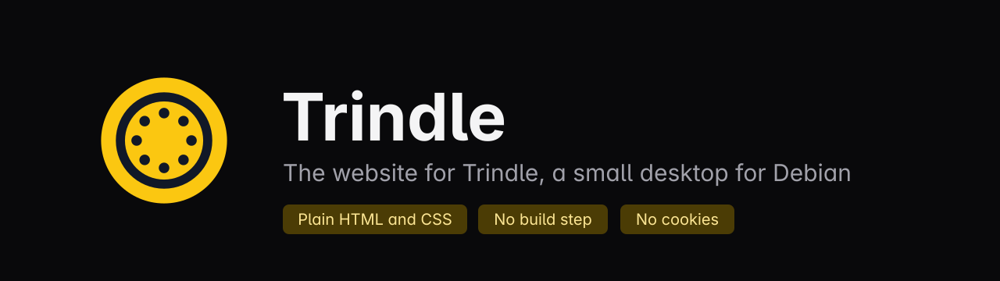
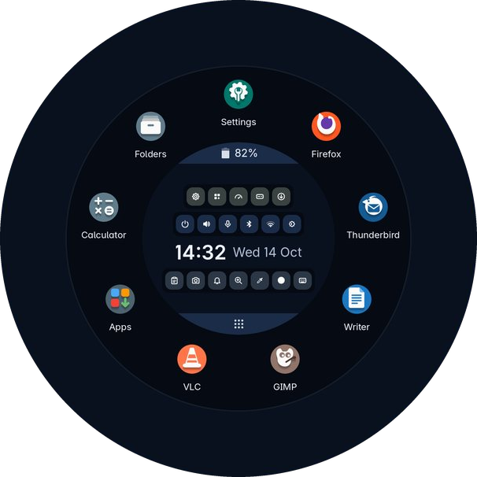
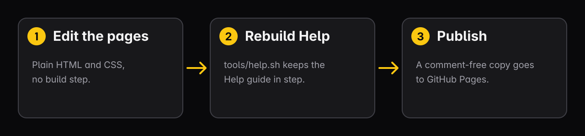
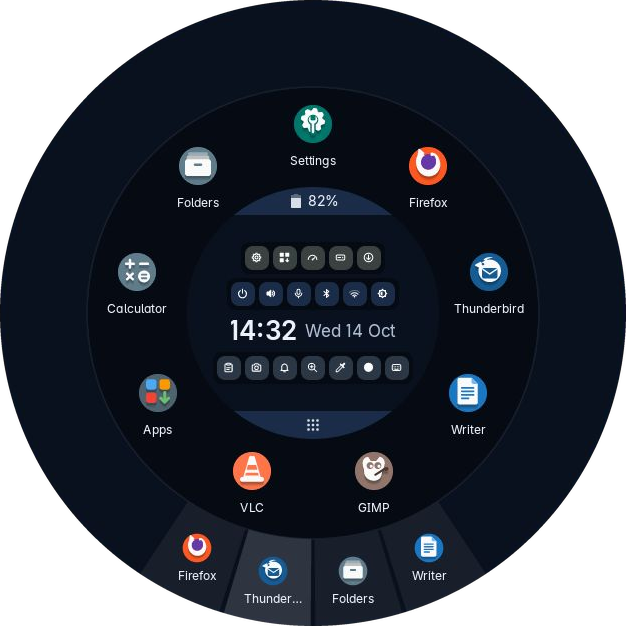
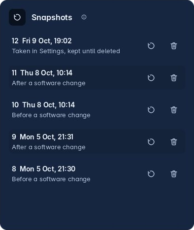

<p align="center"></p>

<p align="center">


</p>

This is the website for [Trindle](https://trindle.org), a small desktop for Debian with no bar, no dock and no menu, only one ring. The pages are plain HTML and one style sheet.

Choose it if you want a site that loads fast, sets no cookies, loads one small script from Buildmorphic and nothing else from another company, and says only what the beta can do today.

<p align="center"></p>

## How it works



## Quick start

There is nothing to install. Serve the folder and open it:

```sh
python3 -m http.server 8000
```

Then open <http://localhost:8000>. Every link between pages is relative, so the pages also open straight from a folder on disk.

## What is on the site

<table>
<tr>
<td width="50%"><br><b>Real pictures only.</b> Every screenshot comes from Trindle itself.</td>
<td width="50%"><br><b>Only what works today.</b> Features still being built are on the Next page, and nowhere else.</td>
</tr>
</table>

## What it does

- A home page that opens with moving words and a ring that leans towards your pointer. One button stops all the movement, and it stays still if your computer asks for less motion.
- A tour of the desktop with a strip of chapters that follows you down the page.
- Safety, Install, About, Next, News and Thanks pages, with a working model of the ring to try in the browser.
- A Help guide, built from Trindle's own notes.
- Works from 320 to 1,400 pixels wide with no sideways scrolling, built to meet WCAG AA, with the known gaps listed on its accessibility page.
- No cookies, no analytics, no accounts and nothing loaded from anywhere else.

## Settings

There are none. The site reads no environment and keeps no configuration.

## Where your data lives

Nowhere. The site stores nothing in your browser and collects nothing. GitHub Pages, like any web host, sees your IP address when it serves a page. The privacy page says so.

## Security

The site is static files, so there is no server code to attack. Anything that could harm a visitor, such as a script that misbehaves or a link that goes somewhere it should not, is worth reporting. See [SECURITY.md](SECURITY.md).

## Building it yourself

There is no build step, and `style.css` is the one style sheet. Two pages are made by tools, and the rest is hand-written HTML.

### Two pages are made by tools

- `help.html` is made from the Trindle repository's `spec/help-notes.md`, which is kept outside the public repository. The tool expects that repository in a folder named `trindle` beside this one.
- The list of projects on `thanks.html`, between its `thanks:start` and `thanks:end` marks, is made by a test in the Trindle repository so that it matches the Thanks page in Settings. That test expects this repository in a folder named `trindle-site` beside it.

### Checking the pages

The script that rebuilds and checks the Help guide, `tools/help.sh`, is kept in the project's working copy and is not part of this repository.

The Help pages are built by Help's docs builder, `trindle-help/tools/site/docs.rs`, in the Trindle Help repository. It checks banned words, em dashes, missing alt text, broken links, heading case and colour contrast:

```sh
rustc --edition 2021 -O tools/site/docs.rs -o target/site-docs
target/site-docs --check
```

Run those two commands from the root of the Trindle Help repository.

To check the Thanks list and the names that must not appear on any page, run these in the Trindle repository with this one beside it:

```sh
cargo test thanks
TRINDLE_WRITE_THANKS=1 cargo test thanks    # rewrite the list on thanks.html
cargo test names_that_must_not
```

Without this repository beside it, the Trindle repository skips the Thanks check and builds and tests as normal.

## Licence

Copyright The Trindle project. GPL-3.0-or-later, in [LICENSE](LICENSE). The typeface in `fonts/` has its own licence in `fonts/OFL.txt`. Changes are listed in [CHANGELOG.md](CHANGELOG.md).

## Disclaimer

Trindle is in beta testing. The software is provided as it is, without warranty, to the extent the law allows.

Comments are stripped from the published code to keep it lean.
